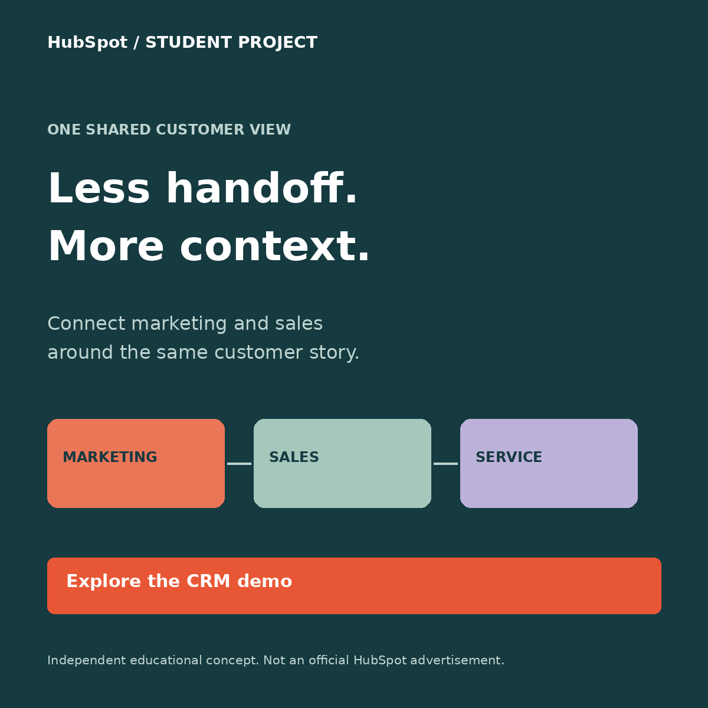

# ЛАБОРАТОРНАЯ РАБОТА №3

МИНИСТЕРСТВО НАУКИ И ВЫСШЕГО ОБРАЗОВАНИЯ РОССИЙСКОЙ ФЕДЕРАЦИИ

Федеральное государственное автономное образовательное учреждение высшего образования «Национальный исследовательский ядерный университет «МИФИ»

Институт финансовой и экономической безопасности (ИФТЭБ)

## Маркетинг (специальные главы)

Тема: Performance-аналитика и оптимизация продвижения HubSpot

Выполнила: студентка группы Б23-712 Клименко Яна

Проверил: ассистент кафедры финансового мониторинга (№75) Никулушкин Максим Алексеевич

Москва, 2026 г.

## Рабочая версия до апробации

Этапы 1–2 подготовлены как план. Для этапа 3 подготовлены сайт, события и протокол сбора данных. Числовые результаты GA4 и Яндекс Метрики, скриншоты и итоговый выбор системы добавляются после реального исследования. Этап 4 содержит методику расчётов и явно обозначенный сценарный прогноз. Эта версия не подтверждает проведение эксперимента.

# 1. Цель, объект и преемственность

Цель — разработать продвижение B2B-платформы HubSpot, подготовить сопоставимое измерение поведения посетителей в GA4 и Яндекс Метрике и сформулировать проверяемые улучшения сайта.

Объект — платформа HubSpot, объединяющая CRM и инструменты маркетинга, продаж и обслуживания клиентов. В работе сохраняется ICP из ЛР №1: B2B-компании с 20–500 сотрудниками, прежде всего SaaS, IT и профессиональные услуги. Ключевые роли — руководитель маркетинга, руководитель продаж и RevOps.

Из ЛР №2 сохраняются три барьера: разрыв данных между отделами, сложность начала работы и неопределённость затрат. На сайте проверяется понятность общего клиентского пути и низкобарьерного интерактивного демо. Учебная форма не создаёт аккаунт HubSpot и не отправляет коммерческую заявку.

## Уточнение исходной модели

В ЛР №2 по строкам указаны 9 + 8 + 14 = 31 сделка, тогда как итог равен 22. При использовании округлённых строк медиаплана общий CAC = 90 000 / 31 = $2 903,23. При сохранении дробных ожиданий формул получается 31,392 сделки и CAC $2 866,97. Итог 22 и CAC $4 090 в продолжении не используются.

Рост CR с 2,8% до 5,4% в ЛР №2 рассматривается здесь как исходная гипотеза: в предоставленном PDF отсутствуют размеры выборок, выгрузки и проверка значимости. Поэтому этот рост не принимается за доказанный эффект будущего сайта.

## Разделение трёх видов данных

| Вид | Содержание | Как используется |

| --- | --- | --- |

| Исходные допущения | ARPU $1 100; маржа 82%; отток 1,2% в месяц из ЛР №1 | Для сценарной экономики, не как проверенные тарифы HubSpot |

| План продвижения | Бюджеты, CPM/CPC, CTR, CR и доля сделок | Ожидаемые значения; реклама не запускалась |

| Наблюдения апробации | Реальные посещения, события, сегменты и скриншоты | Заполняются только из GA4 и Метрики |

# 2. Этап 1. Целевая аудитория и таргетинг

Канал — LinkedIn Ads; цель планируемой кампании — переход к демо и последующая квалифицированная заявка. Для учебной апробации рекламный бюджет не расходуется. Реальный запуск потребует разрешения владельца продукта, рабочего предложения и доступного рекламного кабинета.

| Признак | Выбранное условие и обоснование |

| --- | --- |

| География и язык | США; английский язык объявлений и сайта. Один рынок упрощает анализ. Тестовые посещения знакомых выделяются отдельно и не считаются американским рекламным трафиком. |

| Размер компании | ICP 20–500 сотрудников. В доступных категориях кабинета начать с 11–50, 51–200 и 201–500; диапазон 11–50 шире ICP, поэтому 20+ проверять при квалификации. |

| Роли | Head of Marketing, Marketing Director, Head of Sales, Sales Director, Revenue Operations Manager; близкие названия проверять по справочнику кабинета. |

| Отрасли | Software Development, IT Services and IT Consulting, профессиональные B2B-услуги; уточнить доступные названия при настройке. |

| Интересы и навыки | CRM, marketing automation, inbound marketing, sales operations — отдельный тест интересов/навыков, без чрезмерного пересечения всех условий. |

| Группы | Сообщества RevOps, Sales Operations, B2B Marketing. Это тематические ориентиры для подбора; наличие конкретной группы в таргетинге не утверждается без проверки. |

| Исключения | Имеющиеся клиенты и сотрудники при наличии законных списков; нерелевантные стажёрские/учебные роли. Не использовать пол и возраст как замену профессиональному профилю. |

Структура теста: отдельная группа Marketing/RevOps и отдельная Sales. Для сравнения концепций — одинаковые аудитория, период, посадочная страница и распределение бюджета. Сначала оценить CTR, затем качество обращений; победитель по CTR не обязательно выигрывает по CPL или продажам.

# 3. Этап 1. Три рекламные концепции

| Концепция | Сообщение и формат | Гипотеза |

| --- | --- | --- |

| A. Общий контекст | Статичный баннер 1200×1200: “Less handoff. More context.” CTA: “Explore the CRM demo”. | Боль потери информации мотивирует Marketing/RevOps изучить общую CRM. |

| B. Демо без регистрации | Статичный баннер 1200×1200: “See the workflow. Skip the sign-up.” CTA: “Try the interactive demo”. | Низкий порог входа увеличивает переходы к демо. Отдельно проверить дальнейшую заявку. |

| C. Путь клиента | Карусель из трёх карточек: Capture → Connect → Act. Последняя карточка ведёт к демо. | Последовательное объяснение поможет аудитории понять ценность платформы. |

Все макеты — самостоятельные учебные концепции. Они не выданы за официальную рекламу HubSpot и не содержат неподтверждённых обещаний роста выручки или экономии.

Пример: концепция A. Остальные PNG и редактируемые SVG включены в комплект.

Ресурс создания и редактирования: https://indolentmenace.github.io/hubspot-lab3/creative-studio.html — браузерный редактор SVG. Программные исходники и экспортированные версии сохраняются вместе с сайтом. Перед сдачей открыть ссылку без авторизации.

# 4. Ожидаемые показатели таргетированной рекламы

Плановый бюджет LinkedIn — $4 500 на квартал. Источник: перенос $4 500 из поискового бюджета ЛР №2. Общий квартальный лимит сохраняется: SEO $31 500 + Google Ads $36 000 + вебинары $18 000 + LinkedIn $4 500 = $90 000.

| Показатель | Базовый сценарий | Расчёт |

| --- | --- | --- |

| CPM / CTR / CR в лид |  $60 / 0,65% / 5% | Допущения модели, не отраслевой бенчмарк |

| Показы / клики | 75 000 / 487,5 | Бюджет / CPM × 1 000; показы × CTR |

| Лиды / CPL | 24,375 / $184,62 | Клики × CR; бюджет / лиды |

| Лид → клиент | 4%; 0,975 клиента | Ожидаемая величина, не число фактических контрактов |

| CAC |  $4 615,38 | Бюджет / ожидаемые клиенты |

| Выручка за 12 мес. |  $12 053,66 | 0,975 × $12 362,72 на клиента |

| ROAS за 12 мес. | 2,68× | Атрибутированная выручка / рекламные расходы |

Выручка одного привлечённого клиента за первые 12 месяцев: R12 = 1 100 × Σ(0,988^m), m = 0…11 = $12 362,72. Это модель месячного оттока 1,2% без расширения аккаунта и дисконтирования. Первый платёж учитывается в первом месяце. Все клиенты рассматриваются по 12 месяцам с момента привлечения, а не до конца календарного квартала.

ROAS — отношение выручки к рекламным расходам, не прибыль. Условный маржинальный ROAS = ROAS × 82% = 2,20×, до прочих расходов. При 0,975 ожидаемого клиента фактический результат малой кампании может быть нулевым; бюджет нельзя масштабировать на основании дробного прогноза.

## Чувствительность прогноза

| Сценарий | CPM / CTR / CR / сделки из лидов | CPL | ROAS12 |

| --- | --- | --- | --- |

| Осторожный | $80 / 0,40% / 3% / 2% | $666,67 | 0,37× |

| Базовый | $60 / 0,65% / 5% / 4% | $184,62 | 2,68× |

| Оптимистичный | $45 / 0,80% / 7% / 5% | $80,36 | 7,69× |

# 5. Этап 2. Семантика и исключения

Канал — Google Search. В приоритете коммерческие и транзакционные запросы на английском языке. На старте — точное и фразовое соответствие; поисковые запросы проверяются после запуска. Информационные запросы выделены в отдельную группу и не смешиваются с горячим спросом.

| Тип | Примеры ключевых слов | Решение |

| --- | --- | --- |

| Коммерческие | "crm for b2b companies"; "crm for small business"; [marketing and sales crm] | Основная группа: выбор решения для профессиональной задачи. |

| Транзакционные | "crm demo"; "marketing automation demo"; [b2b crm demo] | Основная группа: явное намерение посмотреть продукт. |

| Брендовые | [hubspot crm]; "hubspot demo"; "hubspot pricing" | Отдельная группа и бюджет; не смешивать высокий брендовый CR с небрендовым. В учебном плане не означает право представляться HubSpot. |

| Сравнительные | "hubspot vs salesforce"; "hubspot vs zoho" | Отдельная группа; нужна честная страница сравнения. До её подготовки — не запускать. |

| Информационные | "what is crm"; "how to align sales and marketing"; "crm implementation checklist" | Контент и SEO. В текущую поисковую кампанию демо не включать. |

## География и ограничения показов

США, язык английский; в геонастройках — присутствующие в целевой стране или регулярно находящиеся в ней, а не только интересующиеся ею. Начать с Google Search; поисковые партнёры — отдельный последующий тест. Устройства не отключать до получения данных.

Минус-слова для группы демо: jobs, careers, salary, internship, certification, exam, login, support, cracked, torrent. Информационные how to / what is исключать только в группе транзакционного спроса, чтобы не блокировать отдельную контентную стратегию. Не минусовать слово free автоматически: бесплатный вход соответствует PLG-гипотезе.

Учебный сайт помечен как независимый и не собирает реальные контактные данные. Поэтому объявления подготовлены как макеты; платный трафик на учебную форму не закупается.

# 6. Этап 2. Объявления и экономика поиска

Три варианта сообщений для адаптивных поисковых объявлений. Каждый вариант содержит три заголовка и два описания. Проверка длины: заголовки ≤30, описания ≤90 символов. Перед реальным запуском расширить набор заголовков и проверить политику брендов и посадочную страницу.

## A — общий контекст

Заголовки: CRM For Connected Teams | Bring Sales And Marketing | Explore A Shared Workflow

Описание 1: Explore how a shared CRM connects marketing, sales and customer service.

Описание 2: See an illustrative three-step workflow. No account or contact details needed.

## B — низкий порог входа

Заголовки: Explore The CRM Demo | No Sign-Up For The Tour | See The Customer Journey

Описание 1: Walk through a simple CRM journey before choosing your next step.

Описание 2: Explore an independent student demo. No account required.

## C — проблема передачи лида

Заголовки: Connect Your Customer Data | Make Every Handoff Clear | See A Connected CRM Flow

Описание 1: See how shared customer context can support the next sales conversation.

Описание 2: Try a three-step educational demo and explore the marketing-to-sales handoff.

| Показатель | Базовый сценарий Google Ads |

| --- | --- |

| Бюджет / CPC / клики | $36 000 / $30 / 1 200 |

| CTR / расчётные показы | 3%; 40 000 показов при заданном CTR |

| CR / лиды / CPL | 8%; 96; $375 |

| Лид → клиент / клиенты | 7,4%; 7,104 ожидаемого клиента |

| CAC / ROAS за 12 мес. | $5 067,57 / 2,44× |

При CPC $36, CR 5%, закрытии 5%: CPL $720, ROAS12 0,86×. При CPC $25, CR 10%, закрытии 9%: CPL $250, ROAS12 4,45×. Это границы сценариев, а не подтверждённая точность прогноза. Дробные ожидания сохраняются до конца расчёта.

# 7. Этап 3. Сайт и схема измерений

Сайт: https://indolentmenace.github.io/hubspot-lab3/ . Репозиторий: https://github.com/indolentmenace/hubspot-lab3 . Статическая версия совместима с GitHub Pages. На сайте есть ценностное предложение, иллюстрация общей CRM, интерактивное демо и учебная форма. Пользователь может пользоваться ими без согласия на аналитику.

Рабочая конфигурация хранится в config.js: Measurement ID GA4 и номер счётчика Метрики. Пока владелец не передал эти идентификаторы, внешняя аналитика не подключена. Два счётчика загружаются после согласия посетителя. Поля формы не отправляются в аналитические события; Вебвизор выключен.

| Событие в обеих системах | Условие отправки | Роль |

| --- | --- | --- |

| page_view / просмотр | После согласия и инициализации счётчика | База посещений; автоматическое событие каждой системы |

| cta_click | Клик на CTA; placement = hero / section / request | Сравнение расположения призывов |

| demo_start | Первое открытие первого шага демо на загрузке страницы | Начало продуктового знакомства |

| demo_step | Переход на шаг 2 или 3; параметр step | Диагностика прохождения |

| demo_complete | Нажатие Finish на третьем шаге | Микроконверсия |

| request_start | Первое изменение поля формы | Начало заполнения |

| demo_request | Валидное подтверждение учебной формы | Основная учебная конверсия |

В GA4 событие demo_request помечается ключевым. В Метрике создаются цели типа «Целевое событие» с точным совпадением идентификаторов. Повторное нажатие отправки не создаёт второй demo_request в одной загрузке. Перезагрузка может дать новое событие, поэтому показатели рассчитываются по сеансам/визитам с событием, а не по общему числу его вызовов.

demo_request означает завершение учебной формы. Это не регистрация в HubSpot, не MQL и не продажа. Денежный value не передаётся; фактический ROAS апробации не вычисляется без расходов и подтверждённой выручки.

# 8. Этап 3. Сегменты и контроль получения данных

| Сегмент | GA4 | Яндекс Метрика |

| --- | --- | --- |

| Мобильные | Сегмент сеансов: Device category = mobile | Визиты: Технологии → Устройство → Смартфоны |

| Десктоп | Сегмент сеансов: Device category = desktop | Визиты: Технологии → Устройство → ПК |

| Завершившие форму | Сеансы с Event name = demo_request | Визиты с достижением цели demo_request |

| Начавшие форму | Сеансы с request_start | Визиты с целью request_start |

| Источник апробации | Session source = classmates либо friends; Session campaign = lab3_pilot | UTM Source = classmates либо friends; UTM Campaign = lab3_pilot |

| Техническая проверка | Отдельно: Session source = qa | Отдельно: UTM Source = qa |

Базовый фильтр исследовательских отчётов: Session campaign / UTM Campaign = lab3_pilot и исключение qa. В каждой системе одинаковый календарный период и часовой пояс Москвы. Сегменты строятся на уровне сеанса/визита. Планшеты учитывать отдельной строкой при наличии: они не входят автоматически в mobile + desktop.

GA4: открыть «Исследования» → свободная форма → добавить сегменты сеансов. Добавить Sessions, Session source/medium, Device category. Для количества сеансов с действием применить сегмент с соответствующим Event name. При необходимости дополнительно создать пользовательские аудитории до апробации; аудитории и ретроспективные сегменты не эквивалентны.

Метрика: в отчёте выбрать условия «Визиты, в которых», добавить устройство / UTM / достижение цели; сохранить сегменты. Для каждого события использовать целевые визиты, а не достижения цели.

## Входной контроль перед приглашением участников

1. Один технический проход с utm_source=qa, utm_medium=test, utm_campaign=lab3_qa и debug=1. Разрешить аналитику. 2. Пройти демо и форму. 3. Увидеть события в GA4 DebugView/Realtime и проверить цель Метрики через _ym_debug=2. 4. Сохранить доказательства и только после этого приглашать участников. Сам факт успешного HTTP-запроса ещё не доказывает наличие корректной строки в отчёте.

GA4 может обрабатывать стандартные отчёты 24–48 часов. Для доказательства работы до их появления используются Realtime и DebugView. Это контроль запуска; итоговый анализ всё равно дополняется обработанными отчётами. При отсутствии события причина устраняется и проверка повторяется.

# 9. Этап 3. Протокол апробации

Рекомендуемый учебный объём — 20–30 добровольных участников, по возможности с телефонами и компьютерами. Это организационный ориентир, а не требование преподавателя и не объём, достаточный для доказательства рыночного эффекта. Реальное число людей и визитов фиксируется отдельно.

После технической проверки провести два разных набора посещений: технический qa и исследовательский lab3_pilot. Участники исследования получают одинаковую нейтральную инструкцию и свободно выбирают действия; не просить каждого обязательно отправить форму, иначе CR не отражает самостоятельное поведение.

## Текст приглашения

«Помоги проверить учебный сайт о CRM. Открой ссылку на привычном устройстве, посмотри страницу так, как обычно знакомишься с новым сервисом. Самостоятельно реши, хочешь ли открыть демо и попробовать учебную заявку. Согласие на аналитику добровольное, без него сайт также работает. После посещения напиши, что было непонятно. Реальные контакты вводить не нужно».

## UTM-ссылки

Одногруппники: https://indolentmenace.github.io/hubspot-lab3/?utm_source=classmates&utm_medium=referral&utm_campaign=lab3_pilot

Друзья/семья: https://indolentmenace.github.io/hubspot-lab3/?utm_source=friends&utm_medium=referral&utm_campaign=lab3_pilot

Техническая проверка: https://indolentmenace.github.io/hubspot-lab3/?utm_source=qa&utm_medium=test&utm_campaign=lab3_qa&debug=1&_ym_debug=2

Время сбора: [начало] — [окончание], Москва. Число приглашённых: [ ]. Число подтвердивших посещение: [ ]. Согласие на аналитику фиксируется агрегированно, если оно известно; посещения отказавшихся не восстанавливаются искусственно. Не использовать собственные повторные визиты как разных участников.

Сделать промежуточную проверку после первых 2–3 человек: есть ли оба источника/события и правильный сайт. После завершения дать системам обработать данные, выставить одинаковые даты, сохранить выгрузки и скриншоты. Исходные файлы не редактировать.

Выборка знакомых предназначена для проверки измерений и удобства интерфейса. Она не репрезентативна для лиц, принимающих решение о покупке CRM в США; участники не получают статус целевого B2B-лида автоматически. Английский интерфейс — отдельный возможный фактор затруднений.

# 10. Форма фиксации результатов и доказательств

Таблица ниже заполняется по двум сервисам за один период. Пустые значения означают отсутствие проведённого измерения, а не ноль. В приложенной книге «Факт» расчёты появляются только после ввода исходных данных.

| Показатель | GA4 | Метрика | Источник доказательства |

| --- | --- | --- | --- |

| Период и часовой пояс | [ ] | [ ] | Скриншот настроек периода |

| Всего сеансов / визитов S | [ ] | [ ] | Общий отчёт с фильтром lab3_pilot |

| Сеансы / визиты с demo_start D | [ ] | [ ] | Сегмент с событием / целью |

| С demo_complete C | [ ] | [ ] | Сегмент с событием / целью |

| С request_start F | [ ] | [ ] | Сегмент с событием / целью |

| С demo_request L | [ ] | [ ] | Сегмент с событием / целью |

| CR формы: L / S | [ ] | [ ] | Расчёт |

| Завершение демо: C / D | [ ] | [ ] | Расчёт |

| Завершение формы: L / F | [ ] | [ ] | Расчёт |

## Обязательные скриншоты для отчёта

Рис. 1 — опубликованный сайт с адресной строкой. Рис. 2 — GA4 DebugView с тестовым demo_request. Рис. 3 — обработанный отчёт GA4: период, сеансы и источник. Рис. 4 — GA4: устройства и сеансы с целевым действием. Рис. 5 — Метрика: посещаемость и UTM за тот же период. Рис. 6 — Метрика: конверсии по demo_request и сегменты устройств. Рис. 7 — настройки сегментов в обеих системах, при необходимости два изображения.

Подпись каждого доказательства: какой ресурс/счётчик, какие даты и фильтры, что измеряется, точное число и вывод. Скрыть личные данные профиля, если они попали в кадр. Не подменять изображения интерфейсов нарисованными таблицами или чужим демосчётчиком.

Шаблон аналитического предложения: «За [период] GA4 зафиксировал [S] сеансов, из них [L] с demo_request; CR = [L/S × 100]%. В Метрике — [S] визитов и [L] целевых визитов; CR = […]%. При одинаковых условиях абсолютное расхождение составляет […]». Причину расхождения называть только после проверки.

# 11. Сравнение GA4 и Яндекс Метрики

| Критерий | Google Analytics 4 | Яндекс Метрика |

| --- | --- | --- |

| Модель | События, параметры, ключевые события; гибкие исследования. | Визиты, посетители и цели; удобные прикладные отчёты. |

| Проверка установки | Realtime и DebugView позволяют видеть технические события до полного отчёта. | Проверка счётчика/цели и диагностический параметр помогают отследить отправку. |

| Сегменты | Сегменты сеансов, пользователей и событий; важно выбрать одинаковый уровень. | Условия по визитам и посетителям; для сравнения используются визиты. |

| Сильная сторона для проекта | Событийная схема и дальнейшая связь с Google Ads; подробный разбор пути. | Наглядный анализ целей и поведения; карты кликов могут помочь объяснить затруднения. |

| Ограничения | Обработка отчётов; необходимость правильно выбирать уровень метрики; малая выборка ограничивает выводы. | Разные определения метрик относительно GA4; блокировка счётчика и отсутствие согласия уменьшают наблюдаемую выборку. |

| ROAS | Требует расходов и корректно атрибутированной выручки. | Требует расходов и корректно атрибутированной выручки. |

Показатели отказов нельзя считать идентичными. В GA4 отказ связан с отсутствием вовлечённого сеанса; по стандартному определению вовлечённость включает длительность более 10 секунд, ключевое событие либо 2+ просмотра. В Метрике используется другая логика короткого визита и служебного события «неотказ» с типичным порогом 15 секунд. Поэтому основной вывод строится по понятным целевым действиям, а не по прямому сравнению bounce rate.

Расхождения проверить по порядку: даты и часовой пояс; правильность ID; согласие; блокировщики; фильтры; разные определения сеанса/визита; задержка обработки; повторные события. Наличие разницы само по себе не доказывает ошибку одной системы.

## Выбор системы для продукта

Предварительно для международной стратегии HubSpot с Google Ads основным инструментом выбран GA4, а Метрика — дополнительным инструментом диагностики интерфейса. Это выбор по требованиям продукта. Окончательный эмпирический вывод формируется после апробации: оценить полноту целевых событий, пригодность сегментов и удобство получения трёх метрик. Если данные его не подтверждают, изменить выбор.

# 12. Этап 4. Метрики и три улучшения

| Метрика | Формула | Практический смысл |

| --- | --- | --- |

| CR учебной заявки | L / S × 100% | Какая доля наблюдаемых визитов завершается формой |

| Завершение демо | C / D × 100% | Насколько понятен и проходим интерактивный путь |

| Завершение формы | L / F × 100% | Какова потеря после начала заполнения; отказ от формы = 1 − L/F |

S — сеансы/визиты исследовательской кампании; D, C, F, L — число сеансов/визитов, содержащих соответствующее действие. Знаменатель 0 означает «метрика не определена», а не нулевую конверсию. Для отдельных устройств использовать показатели именно этих сегментов; не усреднять CR устройств без весов.

| Условие, подтверждаемое данными | Предлагаемое улучшение | Проверка |

| --- | --- | --- |

| Низкий C/D; участники не понимают следующий шаг | Упростить текст шагов, сделать кнопку следующего действия заметнее; тестировать одну версию. | Сравнить C/D и CR после изменения; сохранить сопоставимый сценарий и состав устройств. |

| Низкий L/F; затруднения в полях формы | Сделать размер компании необязательным, оставить один обязательный выбор; не менять определение demo_request. | Сравнить L/F; дополнительно оценить потерю информации для квалификации. |

| Мобильный CR ниже десктопа и выявлена проблема расположения CTA | Для мобильной версии добавить компактный CTA после блока демо, не перекрывающий согласие и форму. | Сравнить мобильный CR и клики по новому placement; проверить отсутствие случайных нажатий. |

Пока данные не собраны, это условные рекомендации и критерии их выбора. В окончательном отчёте у каждой рекомендации должен быть факт: число, сегмент, скриншот и наблюдаемая проблема. Улучшения проверяются последовательно; эффекты нельзя механически складывать.

# 13. Сценарный прогноз и вывод

## Числовой пример — НЕ результаты GA4 или Метрики

Пусть в учебном примере S=40, D=16, C=10, F=12, L=6. Тогда CR=15%, завершение демо=62,5%, завершение формы=50%. Эти числа используются только для проверки формул в книге «Пример», они не заменяют апробацию.

| Сценарий | Ожидаемые целевые визиты | CR при S=40 | Рост к 15% |

| --- | --- | --- | --- |

| Без улучшения | 6 | 15% | 0 п.п. |

| Осторожный | 7 | 17,5% | +2,5 п.п.; +16,7% относительно |

| Базовый | 8 | 20% | +5 п.п.; +33,3% относительно |

| Оптимистичный | 9 | 22,5% | +7,5 п.п.; +50% относительно |

Обоснование базового сценария: при прежних 12 начавших форму повышение завершения с 6/12 до 8/12 = 66,7% даёт 8 заявок и общий CR 8/40 = 20%. Это проверяемое допущение, а не гарантированный результат. Демо и мобильный CTA могут изменить состав начавших форму; их эффект оценивается отдельно.

Для малой выборки различие в две заявки не доказывает устойчивый рост. Например, 95% интервал Уилсона для 6 из 40 приблизительно 7,1–29,1%; для 8 из 40 — 10,5–34,8%. Интервалы широки. Для причинного вывода нужен заранее спланированный рандомизированный тест с большим объёмом.

## Вывод на текущем этапе

Разработаны аудитории и три концепции таргетированной рекламы, семантика и три варианта поисковых сообщений, согласованные прогнозы CPL/CAC/ROAS. Подготовлены сайт, единая схема событий и процедура сопоставления GA4 и Метрики. Для завершения эмпирической части необходимо подключить два счётчика, подтвердить получение событий, провести апробацию и вставить подлинные результаты. После этого рекомендации выбираются по измеренным узким местам.

Материалы защиты: 8 слайдов, ориентир 6–7 минут; результаты и окончательный вывод обновляются после исследования. Отчёт и презентация не отправляются преподавателю автоматически. В методичке указано время 20:00 без календарной даты; дату сдачи следует уточнить отдельно.

# 14. Источники и состав комплекта

1. Задание ЛР №3: Предоставленный PDF «3 ЛР.pdf», слайды 2–6.

2. ЛР №1 и ЛР №2: Предоставленные отчёты Клименко Яны по MRD и GTM HubSpot.

3. Описание продуктов HubSpot: https://www.hubspot.com/products

4. Профессиональный таргетинг LinkedIn: https://business.linkedin.com/advertise

5. Формат поисковых объявлений Google Ads: https://support.google.com/google-ads/answer/7684791

6. GA4: обработка данных: https://support.google.com/analytics/answer/11198161

7. GA4: DebugView: https://support.google.com/analytics/answer/7201382

8. GA4: сегменты: https://support.google.com/analytics/answer/9304353

9. GA4: аудитории: https://support.google.com/analytics/answer/9267572

10. GA4: вовлечённость: https://support.google.com/analytics/answer/12195621

11. Метрика: целевое событие: https://yandex.ru/support/metrica/ru/general/goal-js-event

12. Метрика: проверка цели: https://yandex.ru/support/metrica/ru/general/check-goal

13. Метрика: сегменты: https://yandex.ru/support/metrica/ru/general/segmentation-report

14. Метрика: определения: https://yandex.ru/support/metrica/ru/general/glossary

15. GitHub Pages: https://docs.github.com/en/pages/getting-started-with-github-pages/creating-a-github-pages-site

Дата проверки официальных веб-источников: 09.11.2026. Прогнозные значения CPC, CPM, CTR и конверсий являются авторскими сценарными допущениями, а не цитатами из источников.

Комплект: отчёт DOCX/PDF; расчётная книга XLSX; презентация PPTX/PDF; инструкция по подключению и проверке; сайт HTML/CSS/JS; три концепции креативов в PNG/SVG и редактор. Доступ к материалам: https://indolentmenace.github.io/hubspot-lab3/materials.html

